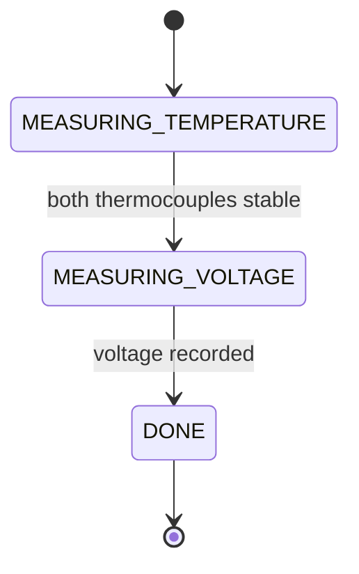
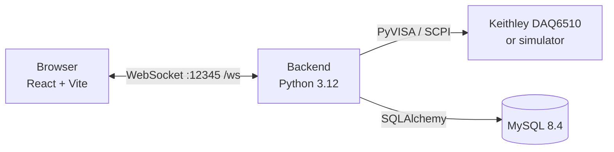
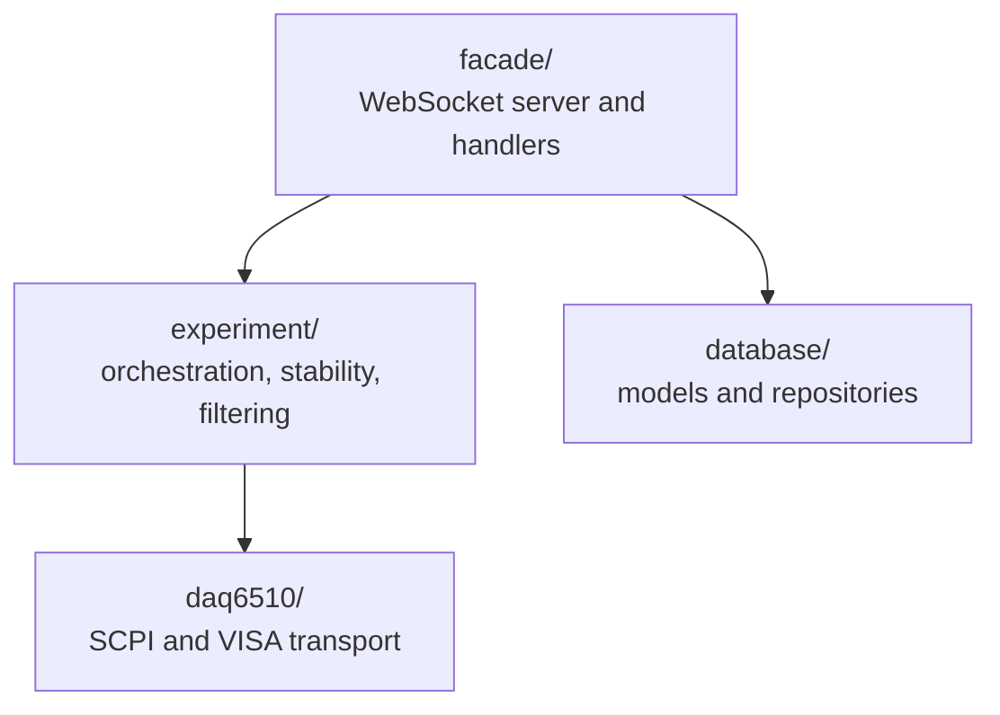

# DAQS — Data Acquisition System for Keithley DAQ6510

[](https://www.python.org/)
[](https://react.dev/)
[](https://vite.dev/)
[](https://www.mysql.com/)
[](https://docs.docker.com/compose/)
[](https://minikube.sigs.k8s.io/)

DAQS is a web application for automating Seebeck coefficient measurements with a Keithley DAQ6510 data acquisition system. The backend controls the instrument over SCPI (PyVISA), monitors thermal stability, and stores every reading in MySQL. The React frontend provides live monitoring, experiment control, and access to recorded data over WebSocket.

<!-- Add a screenshot or short GIF of the live view and uncomment:

-->

**Contents:** [Features](#features) · [Measurement method](#measurement-method) · [Architecture](#architecture) · [Quick start](#quick-start) · [Configuration](#configuration) · [WebSocket API](#websocket-api) · [Development](#development) · [Kubernetes deployment](#kubernetes-deployment) · [Troubleshooting](#troubleshooting) · [Roadmap](#roadmap) · [License](#license)

## Features

- Live monitoring of two thermocouple temperatures and the thermoelectric voltage.
- Experiment control: start, stop, and status tracking from the UI.
- Persistent storage of every measurement, with server-side filtering and pagination.
- Management of multiple devices, connection settings, and channel mappings.
- Simulator mode (PyVISA-sim), allowing the full stack to run without hardware.
- Docker Compose setup for local use and Kubernetes manifests for Minikube.

## Measurement method

The Seebeck coefficient relates the thermoelectric voltage to the temperature difference across a sample:

```text
S = -ΔV / ΔT,    ΔT = T_hot - T_cold
```

Because the result depends on stable temperatures, each experiment runs as a simple state machine:



- **Stability detection.** A sliding-window detector (NumPy) requires both thermocouples to be stable at the same time before the voltage is measured.
- **Filtering.** A scalar Kalman filter smooths the temperature readings.
- **Fault tolerance.** The measurement loop runs in a dedicated thread and tolerates a configurable number of consecutive instrument errors.
- **State handling.** Live data is held in a thread-safe store (`snapshot()`, `full_history()`); each sample is also persisted to MySQL.

## Architecture



The backend is a modular monolith. The WebSocket layer acts as a facade and is the single entry point to the experiment, device, and database layers:



| Area | Technologies |
| --- | --- |
| Frontend | React, TypeScript, Vite |
| Backend | Python 3.12, `websockets`, SQLAlchemy |
| Instrument communication | PyVISA, PyVISA-py, PyVISA-sim |
| Database | MySQL 8.4 |
| Deployment | Docker, Docker Compose, Kubernetes, Minikube |

## Quick start

The default setup can run against the built-in simulator, so no instrument is required (see [Instrument and simulator](#instrument-and-simulator)).

**Prerequisites:** Docker with the Compose plugin; Node.js 22 or later and npm; free ports `12345` (backend), `5173` (frontend), and `3306` (MySQL, configurable).

```bash
git clone <repository-url>
cd DAQS-DAQ6510

# Create the local environment file and replace every `zmien_mnie` value.
# Do not commit .env.
cp .env.example .env

# Start MySQL and the backend. The database is initialised with demo data on first start.
docker compose up --build
```

In a second terminal, start the frontend:

```bash
cd frontend
npm ci
npm run dev
```

Open `http://localhost:5173`. The Vite development server proxies `/ws` to the backend on port `12345`. If the UI does not connect, check the WebSocket connection in the browser developer tools.

To stop the services, run `docker compose down`. This keeps the MySQL volume; add `--volumes` to remove the data as well.

## Configuration

### Database

Set these variables in the root `.env` file, which Compose loads automatically.

| Variable | Description |
| --- | --- |
| `DB_ROOT_PASSWORD` | Password for the MySQL administrative user |
| `DB_NAME` | Name of the database to create |
| `DB_USER` | Application database user |
| `DB_PASSWORD` | Application database password |
| `DB_PORT` | MySQL port published on the host; inside the Compose network the backend always uses `3306` |

### Instrument and simulator

| File | Purpose |
| --- | --- |
| [`Backend/experiment/config/connection_config.json`](backend/experiment/config/connection_config.json) | Connection mode and VISA address |
| [`Backend/experiment/config/channel_config.json`](backend/experiment/config/channel_config.json) | Mapping of measurement roles to slots and channels |
| [`Backend/daq6510/sim/daq6510_sim.yaml`](backend/daq6510/sim/daq6510_sim.yaml) | Simulator definition |

The `use_simulator` field selects the connection mode:

- `true` — use the PyVISA simulator.
- `false` — connect to the instrument at `resource_address`, for example its network address.

In hardware mode, the backend host must be able to reach the DAQ6510, and the channel mapping must match the physical wiring. Running the container alone does not grant access to a USB device or to the measurement network.

### Frontend

By default the frontend connects to the `/ws` endpoint of the host that served the page. In development, Vite proxies this WebSocket endpoint to the backend on `127.0.0.1:12345`. Set `VITE_WS_URL` to override the URL; see [`frontend/.env.example`](frontend/.env.example).

## WebSocket API

The frontend communicates with the backend using JSON messages over `ws://<host>:12345`.

| Action | Description |
| --- | --- |
| `start` | Start an experiment |
| `stop` | Stop the running experiment |
| `status` | Return the current experiment status |
| `update_channel_map` | Update the mapping of roles to channels |
| `update_connection_config` | Update the connection settings |

Responses use a common envelope with the fields `type`, `id`, `ok`, and `payload`. Error details are intentionally not returned to the client.

## Development

```bash
cd frontend
npm ci
npm run dev      # development server
npm run lint     # ESLint
npm run build    # type check and production build in frontend/dist
```

Backend dependencies are listed in [`Backend/requirements.txt`](backend/requirements.txt). The container image uses Python 3.12 and starts the application with `python app.py`. For full-stack development, run MySQL and the backend with Docker Compose and start the frontend as shown above.

### Repository structure

```text
Backend/
├── daq6510/        Driver, SCPI commands and parsers, VISA transport, simulator
├── database/       Models, repositories, MySQL access
├── experiment/     Experiment orchestration, stability detection, channel configuration
└── facade/         WebSocket server and request handlers
frontend/           React + TypeScript application
k8s/                Kubernetes manifests
scripts/            Minikube deployment script
docker-compose.yml  Local backend and MySQL services
```

## Kubernetes deployment

Manifests are in [`k8s/`](k8s/), and the Minikube deployment script is [`scripts/deploy-minikube.sh`](scripts/deploy-minikube.sh). The script requires Docker, Minikube, `kubectl`, Python 3, and a `.env` file with configured credentials.

```bash
./scripts/deploy-minikube.sh
```

Known points to verify before deployment:

- The script enables the Minikube `ingress` add-on (nginx), while [`k8s/ingress.yaml`](k8s/ingress.yaml) specifies the `traefik` ingress class. The class must match the controller available in the cluster.
- The manifests reference the container images `daqs-backend` and `daqs-frontend` in a container registry (`ghcr.io/<owner>/...`). These images must be accessible to the cluster, or the image references must be updated.

## Troubleshooting

| Symptom | Likely cause and fix |
| --- | --- |
| UI reports no connection | Check `VITE_WS_URL` and the backend logs: `docker compose logs -f backend` |
| Port already in use | Change `DB_PORT` in `.env`, or free ports `12345` and `5173` |
| Backend cannot reach MySQL | Wait for the database container to finish initialising, then restart the backend |
| Instrument not found (hardware mode) | Verify `resource_address`, the network route, and that the VISA backend detects the device |
| Ingress returns 404 on Minikube | Ingress class mismatch; see [Kubernetes deployment](#kubernetes-deployment) |

## Roadmap

- [ ] Canvas-based real-time charts (for example uPlot or ECharts)
- [ ] Export of measurements to CSV
- [ ] Automatic Seebeck coefficient fit (ΔV versus ΔT) in the UI
- [ ] Unit and integration tests in CI
- [ ] Packaged installer

## Contributing

Issues and pull requests are welcome. For larger changes, please open an issue first to discuss the approach.

## License

GPL-3.0 license

## Further reading

- [Docker Compose documentation](https://docs.docker.com/compose/)
- [Vite documentation](https://vite.dev/guide/)
- [PyVISA documentation](https://pyvisa.readthedocs.io/)